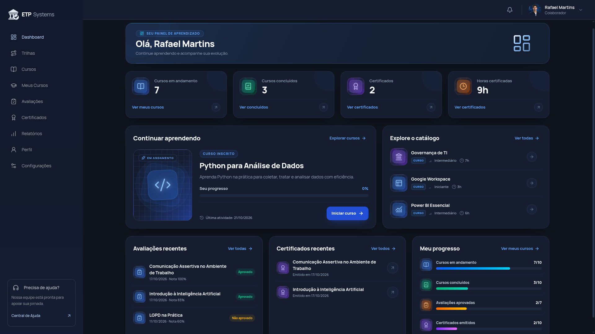

# ETP Systems

**Plataforma de aprendizagem e desenvolvimento corporativo**

Um ambiente para aprender, acompanhar a evolução e reconhecer as conquistas da equipe.

[Sobre o projeto](#sobre-o-projeto) · [Funcionalidades](#funcionalidades-disponíveis) · [Interface](#prévia-da-interface) · [Executar localmente](EXECUCAO_LOCAL.md)

## Sobre o projeto

O **ETP Systems** é um projeto acadêmico do curso de **Análise e Desenvolvimento de Sistemas da Universidade Municipal de São Caetano do Sul (USCS)**. Sua proposta é apoiar a capacitação profissional dentro das organizações, reunindo cursos, trilhas de aprendizagem, avaliações e certificados em uma única plataforma.

O sistema conecta duas perspectivas: a do **colaborador**, que estuda e acompanha sua evolução, e a da **Empresa / RH**, que consulta o desenvolvimento das pessoas vinculadas à organização. Os registros de aprendizagem permitem acompanhar cursos em andamento, resultados e conquistas sem depender de controles separados.

A concepção inicial, registrada nos [materiais acadêmicos](docs/README.md), tomou como cenário a formação e o desenvolvimento de colaboradores do Banco do Brasil. A implementação atual apresenta essa proposta em um ambiente demonstrativo de aprendizagem corporativa.

> **Estágio atual:** aplicação funcional em desenvolvimento, com interface integrada à API e ao banco de dados. O ambiente de demonstração inclui contas e registros ilustrativos para apresentar os fluxos do projeto.

## O problema e a proposta

Quando treinamentos, resultados de avaliações e certificados ficam dispersos, torna-se difícil responder a perguntas simples: **o que cada pessoa está estudando, como está avançando e quais cursos já concluiu?** Para o colaborador, falta uma visão organizada da própria jornada; para o RH, faltam informações reunidas para acompanhar a equipe.

O ETP propõe centralizar essa experiência: organizar o acesso ao conteúdo, registrar o progresso e disponibilizar resultados para quem aprende e para quem acompanha o desenvolvimento profissional.

| Para o colaborador | Para a Empresa / RH |
| --- | --- |
| Encontrar cursos e percorrer trilhas de aprendizagem. | Consultar colaboradores e seus cursos em um único painel. |
| Retomar os estudos e acompanhar o próprio progresso. | Acompanhar progresso, conclusões e resultados de avaliações. |
| Realizar avaliações e consultar notas e certificados. | Visualizar certificados e autorizar novas oportunidades de avaliação. |

## Objetivos acadêmicos

O projeto busca transformar uma necessidade de capacitação corporativa em uma solução de software, articulando:

- **Análise do problema e definição de requisitos:** compreender as necessidades de colaboradores e profissionais de RH.
- **Experiência de uso:** organizar a navegação e apresentar conteúdos, progresso e resultados de forma clara.
- **Modelagem e implementação:** conectar usuários, empresas, cursos, inscrições, avaliações e certificados em uma aplicação web.
- **Qualidade e controle de acesso:** validar regras de aprendizagem, persistência dos dados e separação das informações entre contas e organizações.

A contribuição pretendida é tornar a capacitação mais organizada e seu acompanhamento mais acessível. Impactos como retenção de talentos, mobilidade interna e redução de custos são possibilidades a investigar, não resultados já demonstrados pelo projeto.

## Prévia da interface

*Painel do colaborador em uma sessão de demonstração. Os valores da captura representam aquele momento de uso.*

A interface reúne indicadores, continuidade dos estudos e acesso às principais áreas. O perfil Empresa / RH possui navegação própria para acompanhar colaboradores, avaliações e certificados. As telas se adaptam a computadores, tablets e celulares.

Os [mockups e materiais de apresentação](docs/README.md) registram outras etapas da evolução visual do projeto.

## Funcionalidades disponíveis

### Jornada do colaborador

| Área | O que permite fazer |
| --- | --- |
| **Dashboard** | Consultar cursos em andamento, conclusões, certificados e horas certificadas; retomar os estudos e explorar o catálogo. |
| **Cursos e aulas** | Buscar e filtrar cursos, consultar detalhes, realizar inscrições e estudar os conteúdos disponíveis em vídeo ou texto. |
| **Trilhas de aprendizagem** | Inscrever-se em conjuntos de cursos relacionados e acompanhar o progresso agregado da jornada. |
| **Meus Cursos** | Consultar inscrições, continuar a última aula acessada e registrar a conclusão de aulas. |
| **Avaliações** | Responder questões, consultar notas e tentativas anteriores e revisar o gabarito após a aprovação. |
| **Certificados** | Visualizar documentos emitidos após aprovação em cursos habilitados e baixar o PDF. |
| **Relatórios** | Acompanhar indicadores pessoais, evolução mensal e histórico de avaliações; exportar um CSV da atividade do ano corrente. |
| **Perfil** | Atualizar dados pessoais, objetivo de aprendizagem e nível de experiência. |

### Acompanhamento pela Empresa / RH

| Área | O que permite fazer |
| --- | --- |
| **Visão geral** | Consultar indicadores de aprendizagem e progresso dos colaboradores da organização. |
| **Colaboradores** | Buscar pessoas, filtrar por área ou situação e consultar cursos, progresso e resultados individuais. |
| **Avaliações** | Consultar notas e tentativas; autorizar uma tentativa extra quando as oportunidades se esgotarem sem aprovação, registrando motivo e responsável. |
| **Certificados** | Consultar o acervo da equipe, visualizar miniaturas, ampliar o mesmo documento emitido ao colaborador e baixar o PDF. |
| **Configurações** | Personalizar o nome de exibição e os contatos locais, consultar informações da conta e encerrar a sessão. |

O acesso considera o perfil autenticado: o colaborador consulta seus próprios registros e o RH acompanha as pessoas vinculadas à sua empresa.

### Como a aprendizagem acontece

1. O colaborador encontra um curso ou uma trilha e realiza a inscrição.
2. Acessa as aulas disponíveis e registra sua conclusão para atualizar o progresso.
3. Realiza a avaliação e consulta o resultado. As avaliações publicadas usam nota mínima de **80%** e **duas tentativas iniciais**.
4. A aprovação em um curso habilitado gera o certificado, disponível para consulta e download.
5. O RH acompanha esses registros e pode autorizar uma tentativa extra quando as condições forem atendidas.

A conclusão das aulas e a emissão do certificado são registros distintos: concluir aulas não emite o documento automaticamente. **Horas certificadas** correspondem à carga horária dos cursos certificados, não a uma medição do tempo de estudo.

## Escopo atual e próximas evoluções

A versão atual prioriza o fluxo de aprendizagem e o acompanhamento pelo RH. Alguns pontos ainda estão em desenvolvimento ou possuem funcionamento limitado:

| Recurso | Situação atual |
| --- | --- |
| **Conteúdo do catálogo** | Parte dos cursos já possui aulas e avaliações; os demais indicam conteúdo em preparação. |
| **Preferências e configurações** | Formatos de conteúdo, lembretes, acessibilidade e dados de exibição/contato da empresa ficam no navegador. As preferências não enviam notificações por e-mail ou push. |
| **Central de ajuda** | Possui conteúdo de orientação; a solicitação de suporte é simulada. |
| **Gestão de acesso** | Cadastro público, recuperação e alteração de senha e login Google/Microsoft ainda não estão disponíveis. |
| **Certificados** | Consulta autenticada e PDF disponíveis; a verificação pública de códigos ainda não foi implementada. |
| **Gestão de conteúdos pelo RH** | O painel acompanha a aprendizagem; ainda não oferece criação de cursos, edição de trilhas ou administração de conteúdos. |
| **Tutor com inteligência artificial** | Planejado para explicar conteúdos, esclarecer dúvidas e apoiar os estudos. Ainda não há integração ativa com um provedor de IA. |

As próximas evoluções devem ampliar essas capacidades e validar a experiência com usuários. A documentação acadêmica inclui propostas e protótipos que podem representar etapas anteriores ou funcionalidades futuras.

## Tecnologias e organização

A aplicação possui três partes principais: a interface utilizada no navegador, a API que aplica as regras do sistema e o banco que armazena os registros.

| Camada | Tecnologias | Responsabilidade |
| --- | --- | --- |
| **Frontend** | React, TypeScript, Vite e Tailwind CSS | Interface, navegação e interação com os dois perfis. |
| **Backend** | Java, Spring Boot, Spring Security e JPA | Regras de negócio, autenticação e acesso aos dados. |
| **Banco de dados** | MySQL e Flyway | Persistência e evolução versionada da estrutura do banco. |
| **Ambiente e validação** | Docker Compose, testes Java/Node e Playwright | Execução local, verificações automatizadas e testes de interface. |

## Executar e conhecer a implementação

O passo a passo de instalação, as contas de demonstração e os comandos de validação estão no **[Guia de execução local](EXECUCAO_LOCAL.md)**, na raiz do repositório.

| Documento | Conteúdo |
| --- | --- |
| [Execução local](EXECUCAO_LOCAL.md) | Pré-requisitos, inicialização, configuração, testes e solução de problemas. |
| [Frontend](frontend/README.md) | Estrutura da interface, rotas e desenvolvimento com React. |
| [Backend](backend/README.md) | API, autenticação, regras de negócio e integração com o banco. |
| [Banco de dados](database/README.md) | Modelo de dados e orientações sobre as migrações. |
| [Painel Empresa / RH](frontend/src/pages/Empresa/README.md) | Escopo da organização, tentativas extras e visualização de certificados. |
| [Documentação acadêmica](docs/README.md) | Relatório, apresentação e evolução dos protótipos. |

## Equipe

Equipe identificada no relatório acadêmico do projeto:

- Leonardo Ferreira
- Matheus Batista
- Miguel Varjão
- Nicolas Mendes
- Rafael Melo
- Vinicius Galbini
